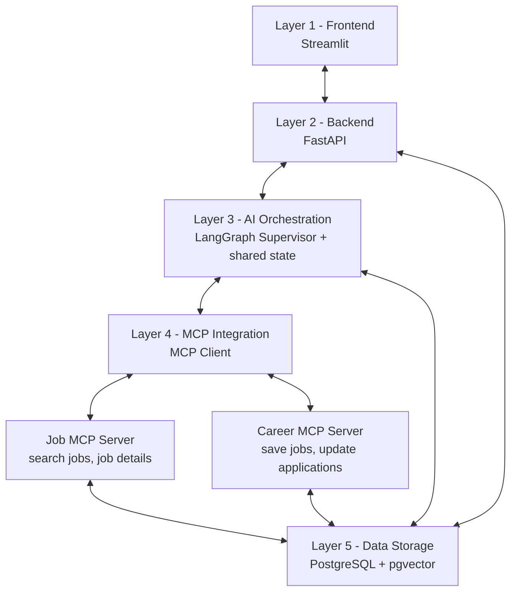

# AI Career Copilot

An end-to-end, multi-agent career assistant. Upload a resume, and the system extracts a structured profile, finds matching jobs, scores each match, explains skill gaps and tracks your applications. It is built as a **5-layer architecture** with FastAPI, LangGraph, MCP servers, PostgreSQL + pgvector and Streamlit.

> **Core rule:** the AI must never invent qualifications. Resume text is treated as untrusted data, every model output is validated with Pydantic, and scores are computed in code rather than guessed by the model.
---

## Table of contents

- [Features](#features)
- [Architecture](#architecture)
- [Tech stack](#tech-stack)
- [Project structure](#project-structure)
- [Quick start with Docker](#quick-start-with-docker)
- [Local development](#local-development)
- [Configuration](#configuration)
- [Database and migrations](#database-and-migrations)
- [API overview](#api-overview)
- [Testing](#testing)
- [Build phases](#build-phases)
- [Security and privacy](#security-and-privacy)
- [Troubleshooting](#troubleshooting)
- [Learn more](#learn-more)

---

## Features

- **Resume parsing** for PDF and DOCX (5 MB limit, scanned-PDF detection, clear errors).
- **Resume intelligence** with Groq: skills, experience, education, projects and suggested target roles, validated by Pydantic.
- **Persistence**: candidate and resume saved in one transaction; repeated uploads with the same email update the candidate instead of duplicating it.
- **Job discovery** through a custom **MCP server** (live listings from Remotive), normalised into one job schema.
- **Job matching**: skill overlap plus pgvector semantic similarity, with a plain-language explanation of skill gaps.
- **Resume optimisation and review**: a job-specific draft that a review step checks against the original resume.
- **Career tracker**: save jobs and update application status through the Career MCP server.
- **Streamlit dashboard** and a documented **FastAPI** backend (Swagger UI at `/docs`).
- **Docker Compose** setup for the database, backend and frontend.

---

## Architecture



| Layer | Technology | Responsibility |
|---|---|---|
| 1. Frontend | Streamlit | Resume upload, job search, match results, resume editor, tracker |
| 2. Backend | FastAPI | REST APIs, request validation, application services, error handling |
| 3. AI orchestration | LangGraph | Supervisor routes five nodes over one shared workflow state |
| 4. MCP integration | MCP client + custom servers | Tool discovery, validated inputs, tool execution, structured results |
| 5. Data storage | PostgreSQL + pgvector | Candidate profiles, jobs, resume versions, applications, embeddings |

### The five workflow nodes

| # | Node | What it does |
|---|---|---|
| 1 | Resume Agent | Extracts candidate information from the uploaded resume |
| 2 | Job Discovery Agent | Searches and normalises job listings |
| 3 | Job Matching Agent | Scores matches and explains skill gaps |
| 4 | Resume Optimization Agent | Produces a job-specific resume draft |
| 5 | Review Node | Checks evidence and draft quality |

### Resume upload flow

```
Resume (PDF / DOCX)
   -> Resume parser            extracts readable text
   -> Groq LLM                 extracts structured candidate information as JSON
   -> Pydantic validation      checks types and structure
   -> PostgreSQL               saves candidate + resume in one transaction
   -> JSON response            candidate_id, resume_id, profile
```

### Job discovery flow

```
User's job search
   -> LangGraph Job Discovery Agent
   -> Remotive MCP Server       live job listings
   -> Groq LLM                  job summary
```

---

## Tech stack

Python 3.12 · FastAPI · Uvicorn · SQLAlchemy 2 · Alembic · PostgreSQL + pgvector · Pydantic v2 · pypdf · python-docx · LangChain Groq · LangGraph · MCP (Python SDK) · Streamlit · Docker Compose · pytest

---

## Project structure

```
amanai-career-copilot/
├── app/
│   ├── api/                 REST routers (resumes, candidates, jobs, ...)
│   ├── agents/              LangGraph nodes and graph
│   ├── core/                settings and configuration
│   ├── db/                  base, models, session
│   ├── mcp/                 MCP client
│   ├── schemas/             Pydantic schemas
│   ├── services/            parser, resume intelligence, persistence, matching
│   └── main.py              FastAPI app (+ /health)
├── mcp_servers/             Job MCP server, Career MCP server
├── ui/                      Streamlit app (streamlit_app.py)
├── migrations/              Alembic migrations
├── data/                    sample files (do not commit real resumes)
├── evaluation/              evaluation sets and scripts
├── tests/                   pytest tests and runnable test scripts
├── docs/                    extra documentation
├── Dockerfile               FastAPI backend image
├── Dockerfile.streamlit     Streamlit frontend image
├── docker-compose.yml       db + backend + streamlit
├── .dockerignore
├── .env.example
├── alembic.ini
├── requirements.txt
└── README.md
```

---

## Quick start with Docker

**Requirements:** Docker Desktop (or Docker Engine with Compose) and a [Groq API key](https://console.groq.com).

```powershell
git clone <your-repository-url>
cd amanai-career-copilot

# 1. Create your environment file
copy .env.example .env
# Edit .env: set POSTGRES_PASSWORD and GROQ_API_KEY

# 2. Build and start everything
docker compose up --build
```

| Service | URL |
|---|---|
| Streamlit app | http://localhost:8501 |
| FastAPI backend | http://localhost:8000 |
| Swagger UI | http://localhost:8000/docs |
| Health check | http://localhost:8000/health |

Useful commands:

```powershell
docker compose ps                       # service status
docker compose logs --tail 50 backend   # last backend logs
docker compose down                     # stop services (keeps database data)
docker compose down -v                  # stop and delete the database volume
```

The Compose file starts three services:

- **db**: PostgreSQL 17 with a named volume (`postgres_data`) and a health check.
- **backend**: the FastAPI app on port 8000, waiting for a healthy database.
- **streamlit**: the UI on port 8501, calling the backend through `CAREER_COPILOT_API_URL=http://backend:8000`.

> **pgvector note:** the PostgreSQL image must include the pgvector extension. If `CREATE EXTENSION vector` fails, use an image that ships it (for example `pgvector/pgvector:pg17`) in `docker-compose.yml`.

---

## Local development

**Requirements:** Python 3.12, PostgreSQL (with pgvector), a Groq API key.

```powershell
# 1. Create and activate a virtual environment (Windows PowerShell)
py -3.12 -m venv .venv
.\.venv\Scripts\Activate.ps1

# 2. Install dependencies
python -m pip install -r requirements.txt

# 3. Configure environment variables
copy .env.example .env     # then edit .env

# 4. Apply database migrations
python -m alembic upgrade head
python -m alembic current  # should show the latest revision as (head)

# 5. Run the backend
uvicorn app.main:app --reload

# 6. Run the frontend (new terminal, venv activated)
streamlit run ui/streamlit_app.py
```

Open http://127.0.0.1:8000/docs to try the API, and http://localhost:8501 for the app.

---

## Configuration

Copy `.env.example` to `.env` and fill in the values. **Never commit `.env`.**

| Variable | Purpose |
|---|---|
| `GROQ_API_KEY` | Groq API key used for resume intelligence and explanations |
| `GROQ_MODEL` | Groq model name (check the Groq console for models available to your account) |
| `POSTGRES_PASSWORD` | Password for the Docker PostgreSQL service |
| `DATABASE_URL` | SQLAlchemy URL, for example `postgresql+psycopg://postgres:<password>@localhost:5432/career_copilot` |
| `APP_NAME` | Application name shown in the API docs and `/health` |
| `CAREER_COPILOT_API_URL` | Backend URL used by Streamlit (set automatically in Docker Compose) |

---

## Database and migrations

Tables: `candidate_profiles`, `jobs`, `applications`, `resumes`. Migrations are managed with Alembic.

```powershell
python -m alembic init migrations                                   # once, at project start
python -m alembic revision --autogenerate -m "describe the change"  # create a migration
python -m alembic upgrade head                                      # apply
python -m alembic current                                           # show current revision
python -m alembic downgrade -1                                      # undo the last migration
```

Always read an autogenerated migration before applying it, and never edit a migration that has already been applied; add a new one instead.

---

## API overview

Interactive documentation is available at `/docs` while the backend runs.

| Method | Path | Description |
|---|---|---|
| GET | `/health` | Health check |
| POST | `/api/resumes/upload` | Upload a PDF or DOCX resume; parse, extract, validate and save |
| GET | `/api/candidates` | List candidates |
| GET | `/api/candidates/{id}` | Get one candidate |
| GET | `/api/candidates/{id}/resumes` | List resume versions of a candidate |

Further endpoints for job discovery, matching, the workflow run and applications follow the same pattern; see Swagger UI for the full, current list.

Example response from `POST /api/resumes/upload` (values depend on the resume and the model):

```json
{
  "message": "Resume uploaded and processed successfully.",
  "candidate_id": 1,
  "resume_id": 1,
  "candidate": {
    "full_name": "Example Candidate",
    "email": "candidate@example.com",
    "experience_years": 3.0,
    "target_role": "Data Scientist",
    "skills": ["Python", "SQL", "Machine Learning"]
  },
  "resume_profile": { "full_name": "Example Candidate", "skills": ["Python", "SQL", "Machine Learning"] }
}
```

---

## Testing

```powershell
# parser unit tests (5 tests)
python -m pytest tests/test_resume_parser.py -v

# print the text extracted from data/sample_resume.pdf
python -m tests.test_resume_real_file

# live Groq extraction (needs GROQ_API_KEY and network)
python -m tests.test_resume_intelligence

# database save with a synthetic profile (no Groq call)
python -m tests.test_candidate_service

# everything
python -m pytest tests -v
```

Use a sample or redacted resume in `data/sample_resume.pdf`. Do not commit real resumes.

---

## Build phases

1. **Project understanding and architecture**: scope, components, data flow, technology choices.
2. **Repository and environment**: folder structure, virtual environment, dependencies, configuration and environment variables.
3. **Database and resume parsing**: PostgreSQL, SQLAlchemy, Alembic and structured resume extraction.
4. **MCP servers**: first server, tool discovery and calls, then the job provider.
5. **Multi-agent workflow**: LangGraph state, routing, matching, resume optimisation and review.
6. **UI, testing and deployment**: dashboard, end-to-end tests, Docker Compose and documentation.

---

## Security and privacy

- Keep `GROQ_API_KEY` and database credentials in `.env` only. `.env` is ignored by Git and Docker builds; `.env.example` is the only committed template.
- A resume is personal data. Do not commit real resumes, do not log full resume text, and tell users that resume text is sent to the model provider.
- Resume content is untrusted input: the prompt tells the model to treat it as data, the extraction step has no tools, and outputs are validated before use.
- Uploads are limited to PDF and DOCX files up to 5 MB.
- Before exposing the app publicly, add authentication, per-user ownership checks and rate limits.

---

## Troubleshooting

| Problem | What to try |
|---|---|
| `ModuleNotFoundError: No module named 'app'` | Run from the project root with `python -m ...` instead of `python path/to/file.py` |
| `JSONDecodeError` from the model reply | Check the finish reason in the error message; the service strips Markdown fences and validates output |
| `Input should be a valid string` for `graduation_year` | Make sure the `graduation_year` before-validator is present in `app/schemas/resume.py` |
| Groq 401 or 404 | Check `GROQ_API_KEY` and that `GROQ_MODEL` exists for your account |
| `type "vector" does not exist` | Enable pgvector: `CREATE EXTENSION IF NOT EXISTS vector;` or use a pgvector-enabled PostgreSQL image |
| Backend container not starting | `docker compose logs --tail 50 backend` and check `.env` values |
| Streamlit cannot reach the backend | Check `CAREER_COPILOT_API_URL` and that `http://localhost:8000/health` responds |
| PowerShell blocks venv activation | `Set-ExecutionPolicy -Scope CurrentUser RemoteSigned` |

---

If this project helped you, give the repository a star .
